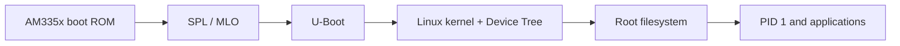

# Lesson 01 - Understanding BeagleBone Black

## Overview

Identify the board's interfaces without wiring anything, then trace how the SoC
becomes a running Linux system.

## Learning Objectives

- Locate power, Ethernet, USB, UART, storage, P8/P9, and user LEDs.
- Distinguish SoC, bootloader, kernel, and root filesystem.
- Record the hardware revision instead of assuming eMMC capacity.

## Prerequisites

A powered-off BBB and the [hardware safety checklist](../prerequisites.md).

## Theory

BBB uses a TI AM335x SoC (commonly AM3358, Cortex-A8 up to 1 GHz) with 512 MB
DDR3. eMMC capacity differs between revisions; check yours. Unlike an MCU
running a single firmware image, the board runs a bootloader, a kernel, and
many isolated userspace processes.

| Interface | Purpose and caveat |
| --- | --- |
| DC jack / mini-USB | Power; follow the manual's ratings and polarity |
| USB Type-A host | USB peripherals, within power limits |
| mini-USB device | To a host PC; gadget serial/network is image-dependent |
| RJ45 Ethernet | 10/100 Mbps LAN |
| UART0 debug header | 3.3 V TTL console, **not** RS-232 |
| microSD / eMMC | Removable vs onboard storage |
| P8/P9 | Multiplexed signals; not every pin is free GPIO |
| USR0-USR3 | User LEDs, separate from power/Ethernet LEDs |
| BOOT / reset / power | Boot selection, reset, power management: three different things |

Use the official
[component diagrams](https://docs.beagleboard.org/boards/beaglebone/black/ch04.html#board-component-locations)
and [system reference manual](https://docs.beagleboard.org/boards/beaglebone/black/index.html)
for revision-specific details.



SPL initializes RAM, U-Boot loads the kernel and Device Tree, and Linux mounts
root. Bootloader media and root media can differ.

## Hands-on Lab

1. **Powered off:** record the printed PCB revision.
2. Find each interface in the table on the board, using the official diagrams.
   Do not attach GPIO wiring.
3. If Linux already runs, **BBB**:

    ```bash
    tr -d '\0' < /proc/device-tree/model; echo
    ```

    This is the Device Tree's model string, not reliable revision detection.

4. Sketch the boot chain, marking where RAM, storage, kernel, and applications
   participate.

## How It Works

Header pins are multiplexed SoC signals; one pin cannot safely serve conflicting
functions. Device Tree and drivers coordinate this. eMMC and HDMI occupy some
header signals. BOOT is sampled at power-on, so pressing reset is not the same
as reapplying power.

## Verification

You can point to every interface, tell USB host from device, explain each boot
stage, and your inventory contains an observed revision.

## Troubleshooting

| Symptom | Check |
| --- | --- |
| Board looks different | Confirm it is BBB, not AI/AI-64 or a derivative |
| Model string disagrees with PCB | Trust the markings; software reflects the image's Device Tree |
| Unsure of UART pins | Stop; use the manual's pin numbering, never guess ground |

## Exercises

1. Why does a Linux application usually keep working when its board driver
   changes?

    ??? success "Answer"
        Applications use stable kernel interfaces (files, sysfs, ioctls,
        sockets). The driver behind that interface can change without changing
        the application.

2. Why is writing GPIO registers directly, as in MCU firmware, unsafe on a
   running Linux board?

    ??? success "Answer"
        The kernel owns that hardware. A direct write bypasses pinmux, locking,
        and driver state, so it can conflict with the eMMC, HDMI, or other
        drivers and corrupt their state.

## Key Takeaways

Hardware, boot software, and userspace are distinct layers. Identify the board
and wire safely before configuring anything.

## Further Reading

- [BBB official overview and diagrams](https://docs.beagleboard.org/boards/beaglebone/black/ch04.html)
- [TI AM3358 product documentation](https://www.ti.com/product/AM3358)
- [Linux Device Tree usage](https://docs.kernel.org/devicetree/usage-model.html)

## Lab Status

**Documented but not tested.** No physical board inspection has been recorded.
