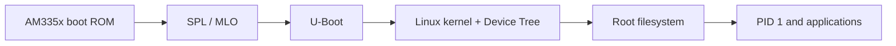

# Lesson 01 - Understanding BeagleBone Black

## Overview

Identify the board's interfaces without wiring peripherals, then trace how a
processor becomes a running Linux system.

## Learning Objectives

- Locate power, Ethernet, USB, UART, storage, P8/P9, and user LEDs.
- Distinguish the SoC, bootloader, kernel, and root filesystem.
- Record hardware revision and avoid assuming eMMC capacity.

## Prerequisites

A powered-off BBB and the [hardware safety checklist](../prerequisites.md).
No software packages or root permissions are needed for visual inspection.

## Theory

The BBB uses a TI AM335x-family SoC (commonly AM3358) with an ARM Cortex-A8
processor rated up to 1 GHz. A SoC combines the CPU with controllers such as
UART, Ethernet MAC, and MMC; external RAM, storage, power management, and an
Ethernet PHY complete the board.

BBB has 512 MB DDR3-family RAM. Early and later revisions can have different
eMMC capacities; inspect your board and Linux rather than assuming 4 GB.
Linux reports usable memory below nominal installed RAM due to reservations.
The running CPU frequency also depends on software and power-management policy.

Unlike a typical microcontroller running one firmware image without a full
virtual-memory OS, this board normally runs a bootloader, Linux kernel, and
many isolated userspace processes. An MCU can run an RTOS; Linux is not inherently
a hard real-time replacement. AM335x PRUs are a later topic.

| Interface | Purpose and caveat |
| --- | --- |
| DC jack / mini-USB | Power inputs; follow the board manual's ratings and polarity |
| USB Type-A host | Connect USB peripherals, subject to power limits |
| mini-USB device | Connect to a host PC; gadget networking/serial depends on the image |
| RJ45 Ethernet | 10/100 Mbps LAN, normally via router/switch |
| UART0 debug header | 3.3 V TTL serial console, **not** RS-232 |
| microSD slot | Removable boot/recovery storage |
| Onboard eMMC | Non-removable storage, separate from microSD |
| P8/P9 | Expansion headers with power and multiplexed signals; not all pins are GPIO |
| USR0-USR3 | Four user LEDs; power and Ethernet LEDs are separate |
| BOOT / reset / power buttons | Boot-mode selection, reset, and power-management input are different |

See the **official labeled connector and component diagrams** in
[BeagleBone Black overview](https://docs.beagleboard.org/boards/beaglebone/black/ch04.html#board-component-locations).
Use the [system reference manual](https://docs.beagleboard.org/boards/beaglebone/black/index.html)
for revision-specific wiring and boot-mode details. We link the original diagrams
rather than reproduce unlicensed figures.



The ROM is built into the SoC. A small first-stage loader typically initializes
RAM, then U-Boot loads the kernel and board description. Linux mounts a root
filesystem and starts userspace. Exact stage names and storage locations depend
on the image. Bootloader media and root filesystem media can differ.

## Hands-on Lab

1. **Powered off:** record the PCB revision printed on the board; photograph it
   for your private inventory. Compare the board to the official diagrams.
2. Identify the mini-USB device connector and Type-A host socket. Explain which
   cable connects to a computer and which socket accepts a keyboard.
3. Find microSD, eMMC, UART debug header, P8/P9, BOOT, reset, power, and USR LEDs.
   Do not attach GPIO wiring.
4. If Linux already runs, **BBB**, inspect its reported model:

   ```bash
   tr -d '\0' < /proc/device-tree/model
   printf '\n'
   ```

   This is the model selected by Device Tree, not guaranteed revision detection.
   If unavailable, use physical markings and the UART log.
5. Sketch the boot chain and label where RAM, persistent storage, kernel, and
   application code participate.

## How It Works

Header pins are multiplexed SoC signals. A pin can serve GPIO, a serial bus,
or another controller, but cannot safely be claimed by conflicting functions.
Device Tree and drivers coordinate Linux's view of that hardware. Onboard
eMMC and HDMI can occupy signals also exposed on the headers.

BOOT changes ROM boot selection when sampled during a power-on reset. U-Boot
can then apply its own search policy. Pressing reset is not necessarily equivalent
to removing and reapplying power.

## Verification

You can point to each interface in the table, distinguish host/device USB, and
describe every stage of the diagram. Your inventory contains an observed
revision, not a guessed eMMC size or kernel version. If you ran the command,
save its actual result rather than assume the expected board model.

## Troubleshooting

- **Different-looking board:** confirm it is BBB, not BeagleBone AI/AI-64 or a
  compatible derivative, before using these instructions.
- **Model does not match markings:** inspect the booted Device Tree and image;
  do not trust software alone to identify PCB revision.
- **Uncertain UART pins:** stop wiring and use the manual's orientation and pin
  numbering. Never infer ground from connector position.

## Exercises

Explain why a Linux application usually survives unchanged when its board driver
changes, and why an MCU firmware register write is not a safe GPIO technique
on a running Linux board.

## Key Takeaways

Board hardware, boot software, and Linux userspace are distinct layers.
Identification and electrical safety precede configuration.

## Further Reading

- [BBB official overview and diagrams](https://docs.beagleboard.org/boards/beaglebone/black/ch04.html)
- [TI AM3358 product documentation](https://www.ti.com/product/AM3358)
- [Linux Device Tree usage](https://docs.kernel.org/devicetree/usage-model.html)

## Lab Status

**Documented but not tested.** No physical board inspection or boot evidence has
been supplied. Record your board revision before hardware work.
