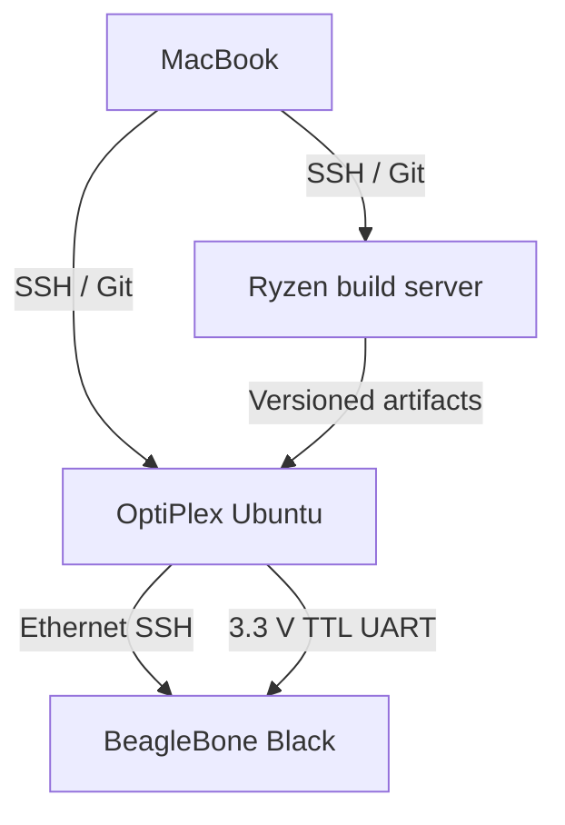

# Lesson 07 - SSH and remote development

## Overview

Develop from your workstation, authenticate to BBB with an SSH key, transfer and
build code, collect logs, and keep UART for when networking fails.

## Learning Objectives

- Connect to an observed address and verify the host key.
- Install a public key without exposing the private key.
- Transfer files, build on the target, and collect logs.
- Explain the roles of OptiPlex, MacBook, Ryzen, SSH, and UART.

## Prerequisites

[Lesson 06](06-ethernet-setup.md), a board account, OpenSSH on both ends
(`openssh-server` on Debian), rsync on both ends, and UART access.

## Theory

SSH authenticates the **server** by host key and the **user** by password or key.
The private key never leaves the client; only `.pub` goes into `authorized_keys`.



Use one shared Git remote. Ryzen builds heavy artifacts; OptiPlex stores and
deploys them.

## Hands-on Lab

1. **BBB console:** find the address and confirm the server runs:

    ```bash
    ip -brief addr
    systemctl status ssh --no-pager
    ```

2. **Host** (replace user/IP): `ssh boarduser@BOARD_IP`. Before accepting,
   compare the fingerprint with the one shown on **BBB via UART**:

    ```bash
    sudo ssh-keygen -lf /etc/ssh/ssh_host_ed25519_key.pub
    ```

3. **Host:** create a dedicated key with a passphrase (don't overwrite existing keys):

    ```bash
    ssh-keygen -t ed25519 -f ~/.ssh/id_ed25519_bbb -C "bbb-linux-lab"
    ssh-copy-id -i ~/.ssh/id_ed25519_bbb.pub boarduser@BOARD_IP
    ```

    On BBB, `~/.ssh` should be mode 700 and `authorized_keys` 600. Never commit
    the private key.

4. **Host:** add to `~/.ssh/config` (mode 600), then use `ssh bbb`:

    ```sshconfig
    Host bbb
        HostName BOARD_IP
        User boarduser
        IdentityFile ~/.ssh/id_ed25519_bbb
        IdentitiesOnly yes
    ```

    Use a router reservation to keep the address stable. Never set
    `StrictHostKeyChecking no`.

5. **Host**, from the repository root, sync source (excluding host binaries)
   and build on the target:

    ```bash
    ssh bbb 'mkdir -p ~/bbb-linux-lab/labs/00-getting-started/led-blink'
    rsync -av --exclude led-blink labs/00-getting-started/led-blink/ \
      bbb:bbb-linux-lab/labs/00-getting-started/led-blink/
    ssh bbb 'cd ~/bbb-linux-lab/labs/00-getting-started/led-blink && make clean && make'
    ```

    `scp -r` also works but would copy a host-built binary. Run the
    [LED lab](05-led-control.md) in an interactive `ssh bbb` session.

6. **Host**, collect logs:

    ```bash
    mkdir -p logs
    ssh bbb 'uname -a; cat /etc/os-release; ip -brief addr' > logs/board-summary.txt
    ssh bbb 'journalctl -b --no-pager -n 200' > logs/boot-journal.txt
    ```

    Redact logs before sharing.

7. **UART recovery**, with power removed: connect a **3.3 V TTL** adapter's
   GND, TX→board RX, RX→board TX per the manual; leave its power wire
   disconnected. Then, **Host** (replace the device):

    ```bash
    picocom --baud 115200 --flow n /dev/serial/by-id/ACTUAL_ADAPTER
    ```

    Ubuntu may require `dialout` group membership; macOS adapters appear as
    `/dev/cu.*`.

## How It Works

scp and rsync tunnel over SSH's authenticated, encrypted channel; remote
commands run on BBB. UART is independent of networking and shows ROM, SPL,
U-Boot, and kernel output before SSH exists. ADB is Android tooling and not
needed for Debian. Avoid agent forwarding; prefer `ProxyJump`.

## Verification

Fingerprint matched over UART, a second key-only login works, a transferred
file's checksum matches, the code builds on BBB, logs are retrieved, and UART
shows boot output with Ethernet unplugged. No secrets in the repository.

## Troubleshooting

| Symptom | Check |
| --- | --- |
| Timeout | Address, link, route, firewall (via UART) |
| Connection refused | SSH server not running or wrong port |
| `Permission denied (publickey)` | User, key path, `.ssh` ownership/modes, server logs |
| Host key changed | Verify via UART, then `ssh-keygen -R BOARD_IP` |
| UART garbage/silence | 115200 8N1, no flow control, crossed TX/RX, common ground, 3.3 V |

## Exercises

1. Record a checksummed artifact with its source commit.

    ??? success "Answer"
        ```bash
        git rev-parse HEAD > artifact.commit
        sha256sum led-blink > led-blink.sha256
        ```

        Store both next to the artifact so anyone can confirm what was built
        and from which source.

2. How can Ryzen supply artifacts without being the always-on board-access host?

    ??? success "Answer"
        Ryzen builds on demand and copies versioned artifacts and checksums to
        OptiPlex (e.g. with rsync). OptiPlex, which is always on and has
        UART/SSH to BBB, deploys them. Ryzen can sleep without affecting access.

## Key Takeaways

Verify both endpoints, keep private keys private, and separate source, build,
deployment, and recovery roles. SSH and UART complement each other.

## Further Reading

- [OpenSSH manuals](https://www.openssh.com/manual.html)
- [rsync upstream](https://rsync.samba.org/)
- [BBB connector diagrams](https://docs.beagleboard.org/boards/beaglebone/black/ch04.html)

## Lab Status

**Documented but not tested.** No board SSH, transfer, or UART session has been
performed.
