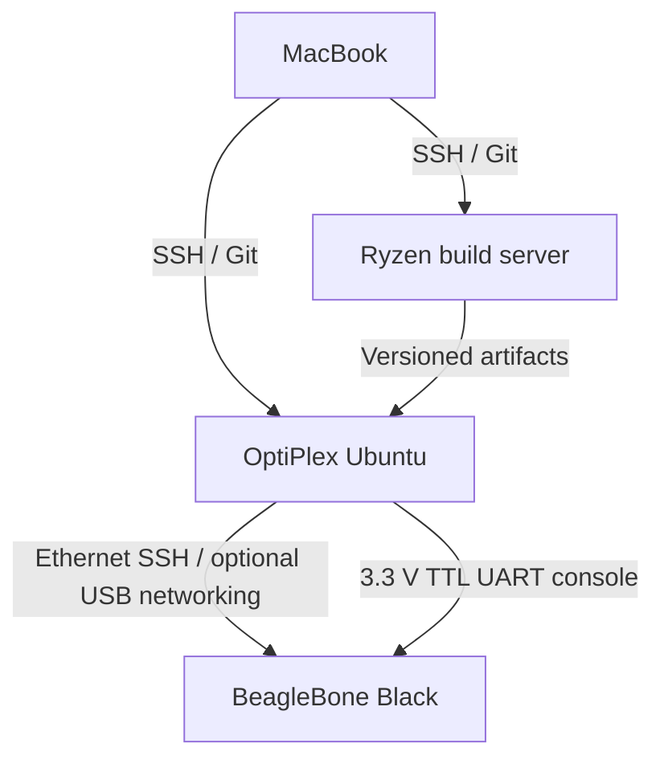

# Lesson 07 - SSH and remote development

## Overview

Develop from your workstation through the OptiPlex, authenticate with an SSH key,
transfer applications, and retain UART for failures before networking starts.

## Learning Objectives

- Connect to an observed board address and verify its host key.
- Install a public key without exposing its private counterpart.
- Transfer files, run target programs, and collect logs.
- Explain the roles of OptiPlex, MacBook, Ryzen, SSH, and UART.

## Prerequisites

[Lesson 06](06-ethernet-setup.md), a reachable board account, OpenSSH client on
the host, and SSH server on BBB. Debian's server package is `openssh-server`
if absent; confirm installed service naming rather than assume all images match.
rsync transfers require rsync on **both** ends. Keep UART/local login access.

## Theory

SSH authenticates the server using its host key and the user using a password or
user key. A private user key stays on the initiating host; only its public key
belongs in the board's `authorized_keys`. Passphrases protect private keys at rest.



Keep a shared remote Git repository, not unsynchronized source copies. Ryzen
later builds toolchains/kernel/images; OptiPlex stores/deploys artifacts. A BBB
does not need to run expensive Yocto builds locally.

## Hands-on Lab

1. **BBB/local console**, find the Ethernet address and confirm SSH:

   ```bash
   ip -brief addr
   systemctl status ssh --no-pager
   ```

   If a service is named differently, inspect the installed server/service.
   The router's DHCP lease table can also identify the board by its observed MAC.
   Do not assume a fixed Ethernet/USB address or that `.local` resolution exists.
2. **Ubuntu host**, replace account/address:

   ```bash
   ssh boarduser@BOARD_IP
   ```

   Before accepting a new host key, compare the presented fingerprint against
   **BBB via trusted UART/local console**, for example:

   ```bash
   sudo ssh-keygen -lf /etc/ssh/ssh_host_ed25519_key.pub
   ```

   Compare the same key algorithm; inspect configured host-key files if Ed25519
   is absent. A reinstall legitimately changes keys, but so can an impersonator.
3. **Host**, create a dedicated user key if one does not already exist:

   ```bash
   ssh-keygen -t ed25519 -f ~/.ssh/id_ed25519_bbb -C "bbb-linux-lab"
   ```

   Choose a passphrase. Do not overwrite an existing key. Never copy or commit
   `id_ed25519_bbb`; its `.pub` file is the shareable half.
4. **Ubuntu host**, install the public key using current account authentication:

   ```bash
   ssh-copy-id -i ~/.ssh/id_ed25519_bbb.pub boarduser@BOARD_IP
   ssh -i ~/.ssh/id_ed25519_bbb boarduser@BOARD_IP
   ```

   If `ssh-copy-id` is unavailable on MacBook, use Ubuntu or append the public-key
   line through an existing trusted login. On BBB, the account should own its
   home/`.ssh` files; typically `.ssh` is mode 700 and `authorized_keys` is 600.
   Test a second key-authenticated connection before changing authentication policy.
5. **Host**, add a reviewed block to `~/.ssh/config`, replacing the address/user:

   ```sshconfig
   Host bbb
       HostName BOARD_IP
       User boarduser
       IdentityFile ~/.ssh/id_ed25519_bbb
       IdentitiesOnly yes
   ```

   Protect the config (`chmod 600 ~/.ssh/config`) and connect with `ssh bbb`.
   A reservation on your router keeps the alias stable without forcing board-side
   static configuration. Do not set `StrictHostKeyChecking no`.
6. **Host**, from the repository root, transfer source:

   ```bash
   ssh bbb 'mkdir -p ~/bbb-linux-lab/labs/00-getting-started'
   scp -r labs/00-getting-started/led-blink \
     bbb:bbb-linux-lab/labs/00-getting-started/
   rsync -av --exclude led-blink labs/00-getting-started/led-blink/ \
     bbb:bbb-linux-lab/labs/00-getting-started/led-blink/
   ```

   SCP demonstrates simple copying. rsync synchronizes the source directory and
   excludes the host-built `led-blink` executable; the trailing slash copies contents.
   SCP may have copied a host binary already, so force a fresh target build next.
   No `--delete` is used; review destinations before enabling deletion.
7. **Host**, build and inspect remotely:

   ```bash
   ssh bbb 'cd ~/bbb-linux-lab/labs/00-getting-started/led-blink && make clean && make'
   ssh bbb 'ls -1 /sys/class/leds/'
   ```

   To run the [LED lab](05-led-control.md), use an interactive `ssh bbb` session,
   discover the actual LED directory, and run scoped `sudo` there. Do not run a
   copied x86 executable on ARM or hardcode an LED name.
8. **Host**, collect logs without modifying the board:

   ```bash
   mkdir -p logs
   ssh bbb 'uname -a; cat /etc/os-release; ip -brief addr' > logs/board-summary.txt
   ssh bbb 'journalctl -b --no-pager -n 200' > logs/boot-journal.txt
   ```

   Restricted journal/kernel access may need authorized permissions; an interactive
   `ssh -t bbb` is appropriate for a sudo prompt. Redact logs before publication.
9. Set up **UART recovery** with power removed: use the manual's exact debug-header
   ground/TX/RX pins, connect adapter TX to board RX and vice versa, and leave the
   adapter power wire disconnected. On the Linux host, identify the new adapter
   under `/dev/serial/by-id/` if available. Use a 3.3 V TTL adapter only.

   Example **Host** terminal after replacing the observed device:

   ```bash
   picocom --baud 115200 --flow n /dev/serial/by-id/ACTUAL_ADAPTER
   ```

   Standard BBB boot console is commonly 115200 8N1 with no flow control; confirm
   the actual image/manual settings. On Ubuntu, serial-device access may require
   `dialout` membership and a fresh login. Use `picocom --help` for exit keys.
   macOS adapters commonly appear as `/dev/cu.*`; discover rather than guess.

## How It Works

SCP (modern clients commonly use SFTP internally) and rsync-over-SSH use the SSH
authentication/encryption channel. Remote commands run on BBB, not the host.
UART works independently of Ethernet configuration and can show ROM/SPL/U-Boot/
kernel output before an SSH server exists.

ADB is Android's debugging protocol and requires an ADB daemon plus compatible
transport. It is common on Android-derived systems, not a baseline requirement
for BeagleBoard Debian. Use SSH for normal Linux development, UART for boot/recovery.
Avoid SSH agent forwarding by default; use explicit host keys or a reviewed
`ProxyJump` setup rather than sharing private keys across machines.

## Verification

Confirm the server fingerprint over trusted console, open a second key-authenticated
`ssh bbb` session, transfer a file and compare its checksum, compile natively on
BBB, and retrieve actual logs. UART should display a boot/login stream even when
Ethernet is unplugged. No passwords/private keys should enter the repository.

## Troubleshooting

- **Timeout:** inspect address, link, route, firewall, and server via UART.
- **Connection refused:** the host is reachable but the server/port may not be active.
- **Permission denied (publickey):** inspect selected user/key, ownership/modes,
  server configuration, and server logs through the trusted console.
- **Host key changed:** verify the new fingerprint via UART first; only then use
  `ssh-keygen -R BOARD_IP` (and the alias if needed) to remove the stale entry.
- **UART gibberish/silence:** confirm baud/flow, adapter voltage, common ground,
  correct crossed TX/RX, device access, and pin orientation.

## Exercises

Record a checksummed artifact and its source commit. Describe how the Ryzen server
can supply that artifact without becoming the always-on board-access host.

## Key Takeaways

Verify both endpoints, keep private keys private, and separate source, build,
deployment, and recovery roles. SSH and UART complement each other.

## Further Reading

- [OpenSSH manuals](https://www.openssh.com/manual.html)
- [rsync upstream](https://rsync.samba.org/)
- [BBB connector diagrams](https://docs.beagleboard.org/boards/beaglebone/black/ch04.html)
- [Android ADB documentation](https://developer.android.com/tools/adb)

## Lab Status

**Documented but not tested.** No board SSH, file transfer, remote build, or UART
session was performed. Host fixture tests do not establish remote connectivity.
