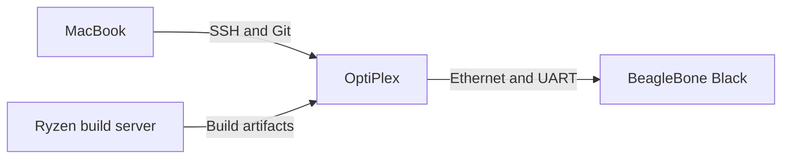

# From first boot to your own Linux board

**A hands-on learning lab for BeagleBone Black.** Start with a working Debian
board, learn what Linux exposes, and progressively take ownership of the
toolchain, boot process, kernel, drivers, and complete system image.

[Start Module 00](00-getting-started/index.md){ .md-button .md-button--primary }
[Explore the curriculum](roadmap.md){ .md-button }

!!! note "An honest lab notebook"
    The introductory lessons are implemented. Host-side checks validate the site
    and code, not physical hardware. Board revision, kernel, image, bootloader,
    LED names, storage numbering, and network configuration must be observed.
    Advanced modules are a roadmap, not completed lessons.

## What you will learn

Understand the boundary between hardware and Linux; identify the active root
filesystem; use subsystem APIs rather than guess register addresses; build and
deploy reproducible software; diagnose failures with logs and UART; eventually
assemble an image and BSP you can explain.

## Your lab bench

| System | Role |
| --- | --- |
| BeagleBone Black | AM335x / Cortex-A8 target, 512 MB RAM, microSD and eMMC |
| Dell OptiPlex / Ubuntu Server | Always-on SSH, UART, artifact storage, future TFTP/NFS |
| Ryzen 9 7950X / Ubuntu Server | On-demand toolchain, kernel, Buildroot, and Yocto builds |
| MacBook | Authoring, terminal, Git, and remote editing |

Ethernet through a home router and unmanaged switches keeps the initial setup
simple. USB networking is optional and image-dependent.

## Learning pathways

- **01 / Bring the board to life**

    ---

    Hardware, boot media, LEDs, Ethernet, SSH, and a recovery path.

    [Getting started](00-getting-started/index.md)

- **02 / Understand the running system**

    ---

    Processes, permissions, peripherals, toolchains, and remote debugging.

    [Foundation roadmap](roadmap.md#phase-a-system-foundations)

- **03 / Own the boot and kernel**

    ---

    U-Boot, Device Tree, Kbuild, modules, and drivers.

    [Kernel roadmap](roadmap.md#phase-b-boot-and-kernel)

- **04 / Build a complete product image**

    ---

    Buildroot, Yocto, a custom BSP, and measured system performance.

    [Integration roadmap](roadmap.md#phase-c-system-integration)

## Quick start

1. Gather the [prerequisites](prerequisites.md), including a safe power supply and
   a recovery console.
2. Read the [board overview](00-getting-started/01-board-overview.md) before
   attaching anything to P8/P9.
3. [Boot existing eMMC](00-getting-started/02-first-boot.md) and record your board
   inventory. If eMMC is not bootable, use the [microSD workflow](00-getting-started/03-microsd-boot.md).
4. Try [LED control](00-getting-started/05-led-control.md), then set up
   [Ethernet](00-getting-started/06-ethernet-setup.md) and
   [SSH](00-getting-started/07-ssh-remote-development.md).

eMMC installation is an **optional destructive lesson**, not a prerequisite for
the rest of Module 00.
