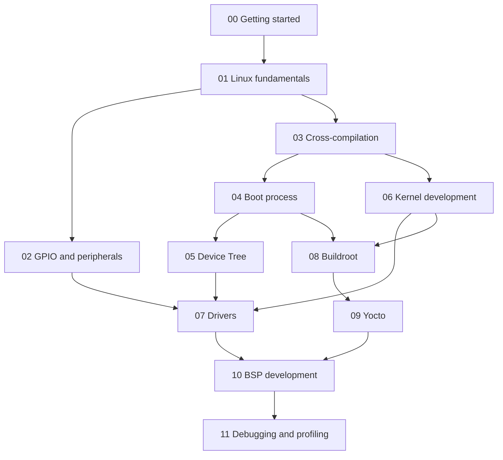

# Curriculum roadmap

Module 00 is implemented; all other modules below are **planned**. These are
scoped milestones, not ready-to-run advanced labs. A milestone is complete only
when its source, explanation, expected results, recovery procedures, and evidence
are present.

Module 00 also includes an optional, documented
[manual microSD assembly lesson](00-getting-started/08-manual-microsd.md).
It uses a pinned Buildroot artifact set; it is not the planned Module 08
Buildroot course or a physically verified boot.

Debugging is practiced throughout; Module 11 consolidates measurement skills.
The arrows are learning dependencies, not a claim that Buildroot depends on
Yocto or that userspace work requires kernel drivers.

## Phase A - System foundations

### Module 01 - Linux fundamentals

**Planned / foundational. Prerequisite: Module 00.**

Explore processes/threads with `ps` and `/proc`; filesystem layout and mounts;
ownership, groups, permissions; sysfs versus procfs; systemd units and journals;
the Linux device model; virtual memory and page cache; network addressing,
routes, and sockets.

**Milestone:** diagnose a failing service, explain a mount and device node, and
identify a permissions failure without using blanket root access.

### Module 02 - GPIO and peripherals

**Planned / intermediate. Prerequisite: Module 01.**

Use the GPIO character device API and version-aware libgpiod tools rather than
start with deprecated GPIO sysfs. Learn pinmux and line ownership before output
control; input edges/interrupts; PWM; I2C addressing and safe probing; SPI modes
and chip selects; UART framing; ADC voltage limits; and a PRU introduction.

**Milestone:** wire one safe peripheral, document pin ownership and electrical
limits, and observe a userspace signal. Do not drive pins shared with eMMC.

### Module 03 - Cross-compilation

**Planned / intermediate. Prerequisite: Module 01.**

Separate host/target architectures; select ARM toolchains and sysroots; compare
static/dynamic linking; use Make and CMake; inspect ELF class, ABI, interpreter,
and dependencies; deploy remotely; debug with GDB/gdbserver.

**Milestone:** cross-build a small application on Ubuntu and explain why it runs
on the target but not natively on an x86 host. Match target libc and ABI.

## Phase B - Boot and kernel

### Module 04 - Linux boot process

**Planned / intermediate. Prerequisites: Modules 00 and 03.**

Trace ROM, SPL/MLO where applicable, U-Boot and its configuration, kernel loading,
Device Tree handoff, initramfs, root filesystem mount, PID 1, kernel command line,
and UART logs. Distinguish the media supplying each boot stage.

**Milestone:** annotate a real boot log and recover from one reversible boot
configuration error using known-good microSD.

### Module 05 - Device Tree

**Planned / intermediate. Prerequisites: Modules 02 and 04.**

Read DTS/DTSI, compile DTBs, follow bindings, describe pin control and GPIO,
inspect overlays and image-specific loading, and explain platform-device matching.
Use kernel bindings rather than invent properties.

**Milestone:** compile and validate a minimal change, show the runtime node,
and prove the intended driver owns the device.

### Module 06 - Linux kernel development

**Planned / advanced. Prerequisites: Modules 03 and 04.**

Explore source structure, Kconfig, reproducible configuration, kernel
cross-compilation, modules and Kbuild, module load/unload, kernel logs, and basic
debugging. Match modules to the target kernel build and preserve a recovery image.

**Milestone:** boot a recorded kernel build and load/unload a small module with
known source/configuration, not just a version string.

### Module 07 - Device drivers

**Planned / advanced. Prerequisites: Modules 02, 05, and 06.**

Progress through a hello-world module, character device, device nodes/udev,
platform driver, Device Tree matching, GPIO consumer, interrupts, I2C client,
SPI client, concurrency/synchronization, and device memory/MMIO. Introduce cleanup
and error paths with every allocation or registration.

**Milestone:** bind a small hardware-backed driver, exercise its interface,
and unload it cleanly. Explain when LED, GPIO, I2C, or other existing userspace
interfaces make a new kernel driver unnecessary.

## Phase C - System integration

### Module 08 - Buildroot

**Planned / advanced. Prerequisites: Modules 03, 04, and 06.**

Learn Buildroot architecture and the available BBB board configuration;
toolchain selection; kernel/U-Boot integration; rootfs customization; custom
packages and overlays; SD/eMMC-compatible image generation; deployment/testing.
Pin a Buildroot release before selecting configuration paths.

**Milestone:** build a reproducible SD image with a custom application and
explain why its boot layout is compatible with the selected board.

### Module 09 - Yocto Project

**Planned / advanced. Prerequisites: Modules 03, 05, and 08.**

Learn OpenEmbedded, BitBake, recipes, layers, `MACHINE`, `DISTRO`, image/kernel
recipes, Device Tree integration, custom applications, and a custom layer.
Select mutually compatible releases/layers before building a BBB image.
Plan shared downloads and sstate caches on the on-demand Ryzen server.

**Milestone:** build and boot a pinned image with an original layer, keep
machine policy separate from distro policy, and explain cache reuse.

### Module 10 - BSP development

**Planned / advanced. Prerequisites: Modules 07, 08, and 09.**

Integrate bootloader, kernel configuration, Device Tree, hardware initialization,
drivers, root filesystem, bring-up logs, and image deployment. Add production
concerns: update/recovery strategy, credentials, licensing, reproducibility,
manufacturing variation, and maintenance.

**Milestone:** deliver a versioned board support package with a documented
recovery path and a repeatable acceptance checklist.

### Module 11 - Debugging and profiling

**Planned / advanced consolidation. Prerequisite: Module 10; early tools appear
in Modules 00, 03, and 06.**

Use UART, GDB/gdbserver, strace, perf, ftrace, kernel logs, crash diagnostics,
memory/CPU profiling, and boot-time analysis. Check kernel/tool support and
measurement overhead before interpreting traces.

**Milestone:** reproduce one fault and one performance bottleneck, record a
baseline, apply a small fix, and demonstrate a measured improvement.

## Suggested order and references

Complete 00, then 01; 02 and 03 can proceed independently. Advance to boot,
Device Tree, and kernel work before drivers and image integration. Never change
the only bootable media while learning a new boot stage.

Reference starting points:
[Linux kernel documentation](https://docs.kernel.org/),
[TI AM335x](https://www.ti.com/product/AM3358),
[Buildroot manual](https://buildroot.org/downloads/manual/manual.html),
[Yocto documentation](https://docs.yoctoproject.org/).

**Next milestone:** physically verify Module 00 with revision/image/kernel
evidence, then implement the first Module 01 lesson using the standard template.
